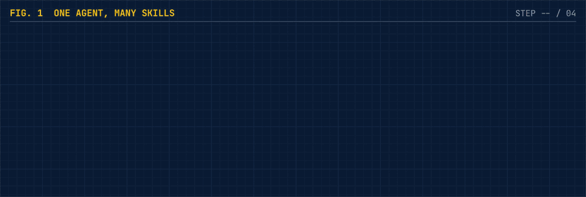
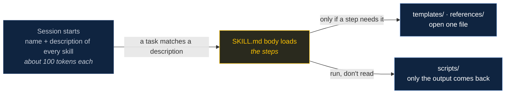
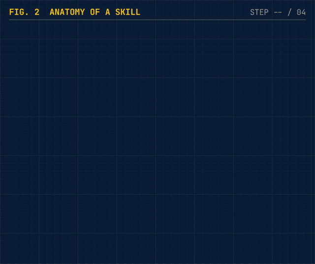
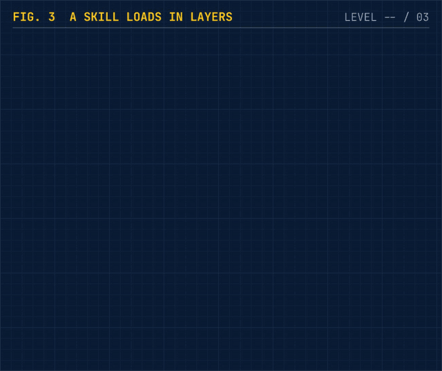
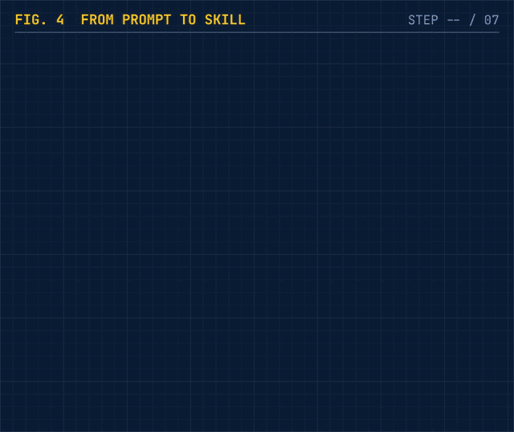
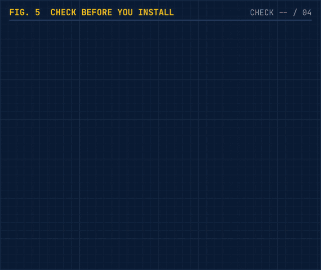
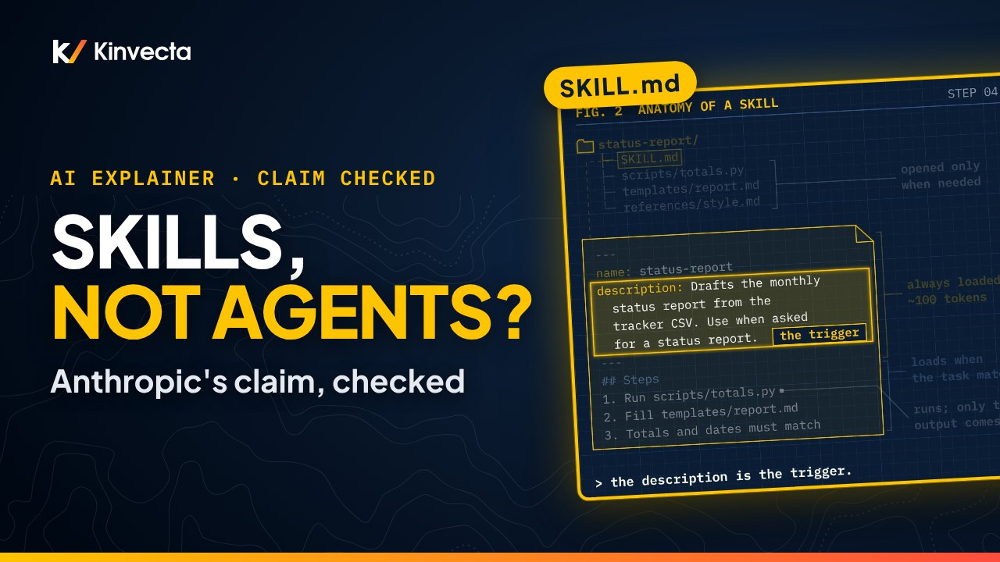
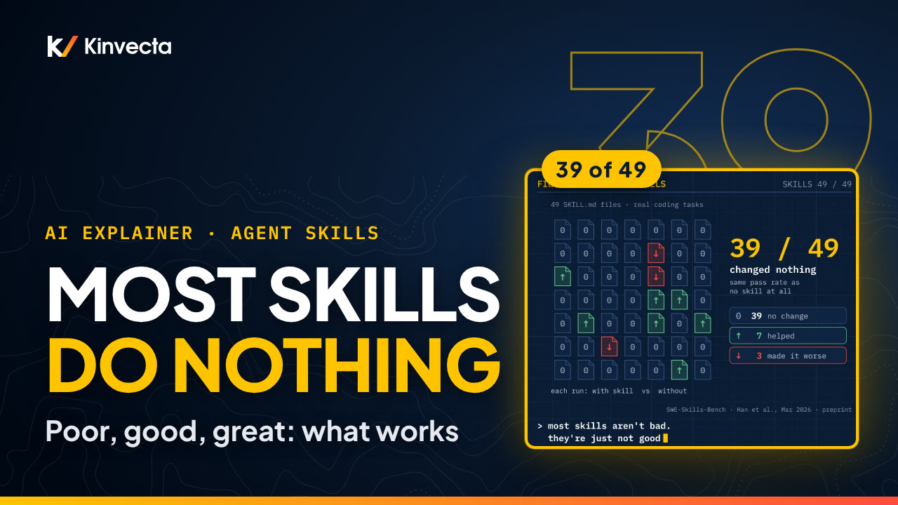

<p align="center">
  
</p>

<p align="center">
  <a href="#skills">skills</a> | <a href="#install">install</a> | <a href="#how-skills-work">how they work</a> | <a href="#write-your-own">write your own</a> | <a href="#install-safely">install safely</a> | <a href="#video">video</a>
</p>

<br>

<p align="center">
  <a href="https://github.com/Kinvecta/agent-skills/actions/workflows/ci.yml"></a>
  <a href="https://github.com/Kinvecta/agent-skills/actions/workflows/security.yml"></a>
  <a href="LICENSE"></a>
  <a href="LICENSE-CONTENT.md"></a>
  
</p>

<p align="center">
  <a href="https://youtu.be/hmE25ADu-AY"></a>
  <a href="https://agentskills.io/specification"></a>
  <a href="#validate"></a>
  <a href="https://github.com/Kinvecta/the-memory-layer"></a>
  <a href="https://github.com/Kinvecta/agent-skills/stargazers"></a>
</p>

> [!WARNING]
> **Not actively maintained.** These skills are published as examples for Kinvecta training videos recorded in 2026. They are provided as is, without warranty, and are not monitored for issues or updates. Agent tools, skill formats and best practices change quickly. **A skill runs with your agent's permissions**, so read every file and test it before you install it. See [install safely](#install-safely) and [maintenance and security](#maintenance-and-security).

<details>
<summary><b>Table of Contents</b></summary>

- [hello](#hello)
- [start here](#start-here)
- [skills](#skills)
- [install](#install)
- [quickstart](#quickstart)
- [how skills work](#how-skills-work)
- [write your own](#write-your-own)
  - [poor, good, great](#poor-good-great)
  - [validate](#validate)
- [install safely](#install-safely)
- [video](#video)
- [the research](#the-research)
- [FAQ](#faq)
- [built with these skills](#built-with-these-skills)
- [star history](#star-history)
- [what's inside](#whats-inside)
- [maintenance and security](#maintenance-and-security)

</details>

## hello

<table>
<tr>
<td width="44%" valign="top">

**Build the agent once. Teach it with skills.**

A skill is a folder with a `SKILL.md` file: a name, a one-line description of when to use it, and the steps. Add scripts, templates and references, and any skills-ready agent can load it when the job comes up.

This repo has worked examples you can copy, each with:

- **A real skill** in the open [Agent Skills format](https://agentskills.io/specification)
- **Test cases** with a baseline-then-skill method
- **Automated tests** for every bundled script
- **A validator** that checks format and risky patterns on every push

</td>
<td width="56%" valign="top">

<br><sub><i>Four agents to build and fix, or one agent and a folder of skills.</i></sub>
</td>
</tr>
</table>

## start here

<table>
<tr>
<td width="33%" valign="top">

**Watch** (about 9 minutes)

Is "build skills, not agents" true? The claim checked against the sources, plus a skill built from scratch.

[Watch on YouTube](https://youtu.be/hmE25ADu-AY) · [the research](#the-research)

Then: what makes a skill poor, good or great, and the approaches people copy.

[Watch part 2](https://youtu.be/6jsMh0dfNe8) · [the rubric](docs/skill-quality.md)

</td>
<td width="33%" valign="top">

**Use** (about 5 minutes)

Copy a skill into your agent's skills folder, run its script, and try its test prompts with and without it.

[Install](#install) · [quickstart](#quickstart)

</td>
<td width="33%" valign="top">

**Write your own**

Four rules drawn from Anthropic's authoring guide, a validator, and the install checks every skill should pass.

[Write your own](#write-your-own) · [install safely](#install-safely)

</td>
</tr>
</table>

## skills

| **skill** | **what it does** | **files** | **tests** |
|---|---|---|---|
| **[status-report](skills/status-report/)** | Drafts the monthly project status report from a tracker CSV. A script does the counting; the model writes the summary; a checklist makes the totals and dates match before it answers. | [](skills/status-report/SKILL.md) [](skills/status-report/scripts/totals.py) [](skills/status-report/templates/report.md) | [](evals/status-report/evals.md) [](evals/status-report/triggers.md) [](evals/status-report/test_totals.py) |
| **[release-notes](skills/release-notes/)** | Drafts release notes for a version from a git log export. A script groups the commits and drops the noise; gotchas cover reverts, squash merges, breaking-change footers and bots; a checklist ties every entry to the script's output. | [](skills/release-notes/SKILL.md) [](skills/release-notes/scripts/group_changes.py) [](skills/release-notes/templates/notes.md) | [](evals/release-notes/evals.md) [](evals/release-notes/triggers.md) [](evals/release-notes/test_group_changes.py) |
| **[skill-review](skills/skill-review/)** | Reviews any skill folder against the [poor, good, great rubric](docs/skill-quality.md). A linter does the mechanical checks and a score out of 10; the model judges the gotchas and scope and names the top 3 fixes. It reports, and edits only when asked. | [](skills/skill-review/SKILL.md) [](skills/skill-review/scripts/lint_skill.py) [](skills/skill-review/templates/review.md) | [](evals/skill-review/evals.md) [](evals/skill-review/triggers.md) [](evals/skill-review/test_lint_skill.py) |

More skills will be added as examples for future videos.

## install

Each skill is a self-contained folder. Copy the folder; don't copy the `evals/` (those are for you, not the agent).

```bash
git clone https://github.com/Kinvecta/agent-skills.git
cd agent-skills
```

| **agent** | **project skills** | **personal skills** |
|---|---|---|
| Claude Code | `.claude/skills/<name>/` | `~/.claude/skills/<name>/` |
| Claude apps (desktop, web) | Zip the skill folder and upload it under your skills settings | |
| Codex, Gemini CLI and other agents that read `.agents/skills/` | `.agents/skills/<name>/` (Gemini CLI also reads `.gemini/skills/`) | `~/.agents/skills/<name>/` |
| VS Code (Copilot) | `.github/skills/`, `.claude/skills/` or `.agents/skills/` | `~/.copilot/skills/`, `~/.claude/skills/` or `~/.agents/skills/` |

For example, for one project in Claude Code:

```bash
mkdir -p /path/to/your/project/.claude/skills
cp -R skills/status-report /path/to/your/project/.claude/skills/
```

Restart the agent, or start a new session, so it reads the new skill's name and description. Folder names and support change quickly, so check each tool's current docs.

## quickstart

The `status-report` skill, end to end.

**1. Run the script on its own.** It's plain Python with no dependencies, and it prints JSON:

```bash
python3 skills/status-report/scripts/totals.py evals/status-report/tracker-2026-10.csv --month 2026-10
# {"month": "2026-10", "total": 7,
#  "counts": {"done": 2, "in progress": 2, "at risk": 1, "blocked": 1, "not started": 1},
#  "due_this_month_not_done": [... 3 tasks ...], "due_next_month": [... 2 tasks ...], "problems": []}
```

**2. Ask your agent.** With the skill installed, in a folder that has the sample CSV:

> Draft the October status report from evals/status-report/tracker-2026-10.csv

The description matches, `SKILL.md` loads, the script counts, the template gets filled, and the checklist compares every number with the script's output.

**3. Test it like Anthropic recommends.** Run the three prompts in [`evals.md`](evals/status-report/evals.md) once **without** the skill and once **with** it, each in a new session. The third prompt is the tricky one: a status with a trailing space and a date in the wrong format. Record each check in a copy of the skill's results sheet, then score it:

```bash
mkdir -p evals/status-report/results
cp evals/status-report/results-template.csv evals/status-report/results/my-run.csv
# fill in result (1/0) and evidence for each check, and the trigger runs from triggers.md
python3 tools/eval_report.py evals/status-report/results/my-run.csv
# pass rate without vs with the skill, which checks the skill fixes, which trigger queries failed
```

The full eval steps (setup, grading with evidence, trigger tests, what to do with the result) are in [`evals/README.md`](evals/README.md).

**4. Run the automated tests:**

```bash
python3 -m pip install pytest
python3 -m pytest -q evals tools
# 43 passed (31 skill script tests + 12 tool tests)
```

## how skills work



<table>
<tr>
<td width="33%" valign="top" align="center">

<br><b>1 · A folder</b><br><sub><code>name</code> and <code>description</code> are required. The description is the trigger: a vague one never fires.</sub>
</td>
<td width="33%" valign="top" align="center">

<br><b>2 · Loads in layers</b><br><sub>Dozens installed, one loaded. Anthropic calls this progressive disclosure.</sub>
</td>
<td width="33%" valign="top" align="center">

<br><b>3 · One library</b><br><sub>A saved prompt becomes a skill, gets tests and a review, and every tool pulls the same copy.</sub>
</td>
</tr>
</table>

## write your own

Three ways to start: write `SKILL.md` by hand, describe the job and let your agent interview you and draft it, or do the job once with the agent and ask it to save what worked. Then follow four rules drawn from Anthropic's [skill authoring best practices](https://platform.claude.com/docs/en/agents-and-tools/agent-skills/best-practices):

| **rule** | **in practice** |
|---|---|
| **1 · The description says what and when** | Third person, with the words people type: *"Drafts the monthly project status report... Use when the user asks for a status report."* |
| **2 · Keep SKILL.md short** | Under 500 lines, only what the model doesn't already know. Put detail in files one level deep. |
| **3 · Fragile steps get code** | Totals, payments, deletions: give an exact script, not a suggestion. |
| **4 · Test first** | Run the task without the skill, note where it fails, then write just enough to fix that. At least three test cases, plus trigger queries. Steps and a scorer: [`evals/README.md`](evals/README.md). |

Use [`skills/status-report/`](skills/status-report/) as a template:

```text
your-skill/
├── SKILL.md            required: name + description, then the steps
├── scripts/            code the agent runs (output only enters context)
├── templates/          output layouts
└── references/         detail the agent reads only when a step needs it
```

### poor, good, great

[`examples/poor-good-great/`](examples/poor-good-great/) has the same `release-notes` skill written three ways, with a walk-through of what changes at each level and the source for each point:

| **level** | **what it has** | **lint score** |
|---|---|---|
| [poor](examples/poor-good-great/release-notes/poor/SKILL.md) | `description: Writes release notes.` and one line of body. It never fires, and adds nothing if it does. | 2.0 / 10 |
| [good](examples/poor-good-great/release-notes/good/SKILL.md) | What and when in the description, short steps, a script for the grouping, a check step | 6.5 / 10 |
| [great](examples/poor-good-great/release-notes/great/SKILL.md) | Plus gotchas from real failures, a "Not for" boundary, a full checklist, and evals with near-miss trigger tests | 9.0 / 10 (10 as installed) |

The full rubric, with a source for every row, is in [`docs/skill-quality.md`](docs/skill-quality.md). To grade your own skill:

```bash
python3 skills/skill-review/scripts/lint_skill.py path/to/your-skill
```

### validate

`tools/validate_skills.py` checks every skill against the [Agent Skills specification](https://agentskills.io/specification) and some safety rules. It uses only the Python standard library and runs on every push.

```bash
python3 tools/validate_skills.py
# ok    release-notes
# ok    skill-review
# ok    status-report
# 3 skill(s), 0 error(s)
```

It fails a skill when:

- `name` isn't 1–64 lowercase letters, digits and hyphens, doesn't match the folder, or uses a reserved word
- `description` is missing, over 1,024 characters or contains angle brackets
- the `SKILL.md` body is over 500 lines
- `SKILL.md` mentions a `scripts/`, `references/`, `templates/` or `assets/` file that doesn't exist
- any file pipes a download into a shell, decodes base64 at run time, contains an absolute local path or looks like it holds a secret

It also warns when a description doesn't say when to use the skill. It checks only `skills/`; the folders in `examples/` are for reading, not installing.

## install safely

<table>
<tr>
<td width="45%" valign="top">

</td>
<td width="55%" valign="top">

**A skill is software.** It runs with your agent's permissions: its shell, its files and its credentials.

In February 2026, the security company Snyk scanned 3,984 public skills: **36.8% had at least one security flaw** and **76 were confirmed malicious**. Before you install any skill, including these:

1. **Read every file**, not just `SKILL.md`
2. **Scan the scripts**
3. **Pin the version** (a tag or a commit, in your own approved copy)
4. **Run it in a sandbox** before it touches real data

If an agent edits a skill, a person reviews the change before it's used again. More in [SECURITY.md](SECURITY.md).

</td>
</tr>
</table>

## video

<table>
<tr>
<td width="40%"><a href="https://youtu.be/hmE25ADu-AY"></a></td>
<td width="60%" valign="top">
<b><a href="https://youtu.be/hmE25ADu-AY">Build skills, not agents? Anthropic's claim, checked</a></b><br>
<sub><b>Published:</b> 22 Oct 2026 · <b>Length:</b> 9:30 · <a href="https://www.youtube.com/playlist?list=PLZ1VbKY-g_Ok">Explainers playlist&nbsp;→</a></sub>
<p>Is it true that Anthropic's engineers stopped building agents? Mostly, but the headline goes too far. The claim checked against the sources; the <code>status-report</code> skill built from scratch; how skills load; four rules for writing one; what SkillsBench measured; and why every skill should be treated like code.</p>
</td>
</tr>
<tr>
<td width="40%"><a href="https://youtu.be/6jsMh0dfNe8"></a></td>
<td width="60%" valign="top">
<b><a href="https://youtu.be/6jsMh0dfNe8">AI Agent Skills: What Makes One Actually Work</a></b><br>
<sub><b>Published:</b> 25 Oct 2026 · <b>Length:</b> 9:40 · <a href="https://www.youtube.com/playlist?list=PLZ1VbKY-g_Ok">Explainers playlist&nbsp;→</a></sub>
<p>Of 49 public software-engineering skills, 39 changed nothing. Why most skills never fire, say too much or go unchecked; what good skills fix; what great ones add (gotchas, boundaries, tests); and the same <code>release-notes</code> skill at all three levels. Uses the <a href="docs/skill-quality.md">rubric</a>, the <a href="examples/poor-good-great/">examples</a> and the <code>skill-review</code> skill.</p>
</td>
</tr>
</table>

Related Kinvecta material: [The Memory Layer](https://github.com/Kinvecta/the-memory-layer) (its brain is run by five skills: ingest, query, lint, reflect and remember) and [Part 2: The operating manual](https://youtu.be/rMirmmTu3VM) (when a rule belongs in `AGENTS.md` and when it belongs in a skill).

## the research

| **source** | **what it says** | **link** |
|---|---|---|
| Zhang & Murag (Anthropic), AI Engineer Code Summit, Nov 2025 | "Don't build agents, build skills instead": one general agent plus domain expertise | [](https://www.youtube.com/watch?v=CEvIs9y1uog) |
| Anthropic Engineering, Oct 2025 (updated Dec 2025) | Skills as onboarding guides; progressive disclosure; security guidance | [](https://www.anthropic.com/engineering/equipping-agents-for-the-real-world-with-agent-skills) |
| Agent Skills specification | The open format: required fields, folders, limits | [](https://agentskills.io/specification) |
| Claude Platform Docs | Skill authoring best practices | [](https://platform.claude.com/docs/en/agents-and-tools/agent-skills/best-practices) |
| Li et al., SkillsBench (v4, June 2026) | Human-curated skills raised the average pass rate from 33.9% to 50.5% across 87 tasks; self-generated skills scored below no skills; compact skills beat comprehensive manuals | [](https://arxiv.org/abs/2602.12670) |
| Snyk, ToxicSkills, Feb 2026 (security-vendor research) | 3,984 public skills: 36.8% with a security flaw, 76 confirmed malicious | [](https://snyk.io/blog/toxicskills-malicious-ai-agent-skills-clawhub/) |
| agentskills.io, Best practices for skill creators (open-standard docs) | Gotchas are "the highest-value content in many skills"; defaults, not menus; "Would the agent get this wrong without this instruction?" | [](https://agentskills.io/skill-creation/best-practices) |
| Anthropic, Improving skill-creator, Mar 2026 (vendor) | Paired evals and description tuning (triggering improved on 5 of 6 public skills); "The skill isn't broken; it's just no longer necessary" (said mainly of capability-uplift skills) | [](https://claude.com/blog/improving-skill-creator-test-measure-and-refine-agent-skills) |
| Gao (Vercel), Jan 2026 (vendor eval, one suite) | The skill was never invoked in 56% of eval cases and scored the same as no skill (53%); an AGENTS.md docs index scored 100% | [](https://vercel.com/blog/agents-md-outperforms-skills-in-our-agent-evals) |
| Han et al., SWE-Skills-Bench (preprint, Mar 2026) | Of 49 public software-engineering skills, 39 changed the pass rate by zero; 7 helped, 3 hurt; mean +1.2% | [](https://arxiv.org/abs/2603.15401) |
| Hong et al., From Anatomy to Smells (preprint, Jul 2026) | An LLM-based detector, checked against 53 hand-labelled files, ran over 238 SKILL.md files: over 99% have at least one smell; 81% bury their gotchas; 69% have no validation step | [](https://arxiv.org/abs/2607.01456) |
| Zhang et al., What Keeps Agent Skills from Being Reusable? (preprint, Aug 2026) | 138,133 public skills: 52.3% lack trigger guidance; over 500 lines averages 4.76 defects vs 1.48 under 50 | [](https://arxiv.org/abs/2608.08453) |
| Cheng et al., Agent Skills' Downstream Utility (preprint, Oct 2026) | The same skill helped one model and harness and hurt another on 36.78% of 87 SkillsBench tasks | [](https://arxiv.org/abs/2610.08875) |
| Yan et al., One Skill Too Many (preprint, Oct 2026) | A similar co-installed skill takes about 1 in 5 runs, and the reply names the substitute in 0.9% of them | [](https://arxiv.org/abs/2610.11647) |
| Liu et al., Lost in Implicit Routing (preprint, Oct 2026) | Recall of the right skill fell from 73.6% to 27.4% as unrelated installed skills grew from 0 to 1,000 | [](https://arxiv.org/abs/2610.18522) |

The rubric built from these sources is in [`docs/skill-quality.md`](docs/skill-quality.md).

## FAQ

<details>
<summary><b>Is this only for Claude?</b></summary>

No. Agent Skills started at Anthropic and became an open standard in December 2025. Many agents now read the same `SKILL.md` folders, including Claude Code, Codex, Gemini CLI and VS Code. Support changes quickly, so check each tool's current docs.
</details>

<details>
<summary><b>Skills or MCP?</b></summary>

Both. MCP connects the agent to your systems (a database, a ticket tracker, a file store). A skill teaches it how to use them well: the steps, the checks, the format your team expects.
</details>

<details>
<summary><b>So should I stop building agents?</b></summary>

No. Skills run inside an agent. The advice is to build one general agent and stop building a new one for every job. Separate agents still make sense when you need isolation, parallel work or different permissions per job.
</details>

<details>
<summary><b>Can the model write its own skills?</b></summary>

It can draft them, and that's a good way to start. But in SkillsBench, skills that models wrote for themselves without a human check scored below having no skills at all. Review, test and trim what it writes.
</details>

<details>
<summary><b>Can I use these at work?</b></summary>

The code is MIT and the content is CC BY 4.0. The repository isn't actively maintained, so review and test each skill, keep your own approved copy, and follow your organization's rules on which data may go into an AI tool.
</details>

## built with these skills

Wrote your own skill from this template? Share it in [Discussions → Show and tell](https://github.com/Kinvecta/agent-skills/discussions/categories/show-and-tell): what job it handles, which agents load it, and what changed when you ran the same task with and without it.

Please don't post secrets, private data or anyone's personal information. Posts are read on a best-effort basis.

## star history

<a href="https://star-history.com/#Kinvecta/agent-skills&Date">
  <picture>
    <source media="(prefers-color-scheme: dark)" srcset="https://api.star-history.com/svg?repos=Kinvecta/agent-skills&type=Date&theme=dark">
    
  </picture>
</a>

## what's inside

| Folder | What it is |
|---|---|
| [`skills/`](skills/) | **Installable skills.** Each folder is one skill: `SKILL.md` plus its scripts, templates and references. |
| [`evals/`](evals/) | **Tests for each skill**: [step-by-step guide](evals/README.md), prompts to run with and without the skill, trigger queries (should and near-miss), a results sheet to fill in, sample data, and pytest tests for the scripts. Not installed with the skill. |
| [`examples/`](examples/) | **Examples for reading, not installing.** [`poor-good-great/`](examples/poor-good-great/) has the `release-notes` skill at three levels, with a sourced walk-through. Not checked by the validator. |
| [`tools/`](tools/) | **`validate_skills.py`**: format and safety checks for every skill. **`eval_report.py`**: scores a filled results sheet (with vs without the skill, per check, trigger tests). Both have their own tests. |
| [`docs/`](docs/) | [`skill-quality.md`](docs/skill-quality.md) (the poor, good, great rubric with sources), plus README images and animations. |

## maintenance and security

This repository is a snapshot that accompanies the videos. It is **not actively maintained**:

- **Formats and support change.** Skill folder locations, frontmatter fields and agent support reflect late 2026. Check each tool's current documentation.
- **Pull requests and issues may not get a response.** Fork the repository if you need changes.
- **Treat every skill as code**, including these. Read every file, pin a version, and run it in a sandbox first.

Automated checks run on GitHub Actions: the skill validator, tests on Python 3.10–3.13, a secret scan of the full history (Gitleaks), CodeQL code scanning and Dependabot updates for the workflows. Passing checks lower the risk but do not prove a skill is safe. To report a vulnerability, see [SECURITY.md](SECURITY.md).

## notes

- Product names are examples, not endorsements.
- No secrets, personal data or audio/video files are stored in this repository. The sample tracker data and git logs are made up.

## license

- **Code** (`skills/*/scripts/`, `tools/`, tests): [MIT](LICENSE)
- **Content** (skill instructions, templates, references, evals, docs): [CC BY 4.0](LICENSE-CONTENT.md)

© 2026 Mark D. Espinoza / Kinvecta.

<br>

<p align="center">
  <a href="https://kinvecta.ai">&nbsp;</a>
  <a href="skills/">&nbsp;</a>
  <a href="evals/">&nbsp;</a>
  <a href="#the-research">&nbsp;</a>
</p>
<p align="center"><sub>If this helped, a star helps others find it.</sub></p>
<p align="center"><sub>Built by <a href="https://kinvecta.ai">Kinvecta</a> · videos, code and labs for teams adopting AI</sub></p>
